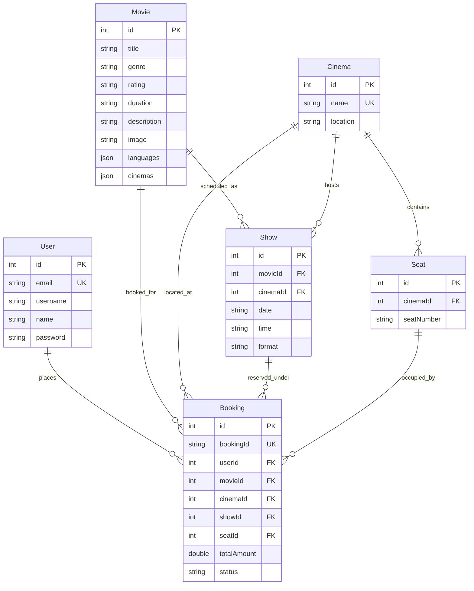

# 🎬 CineReserve — Full-Stack Movie Ticket Booking Web Application

Welcome to **CineReserve**, a production-grade Full-Stack Movie Ticket Booking application built with a **React 19 + TypeScript** frontend, a **Spring Boot 3.x (Java 20/21 LTS)** backend, and a **PostgreSQL** relational database.

---

## 📌 Table of Contents
1. [Architecture Overview](#architecture-overview)
2. [GitHub Repository Setup](#github-repository-setup)
3. [Technology Stack](#technology-stack)
4. [Database Schema & ER Diagram](#database-schema--er-diagram)
5. [REST API Documentation](#rest-api-documentation)
6. [Getting Started & Run Instructions](#getting-started--run-instructions)
7. [Testing](#testing)
8. [Security & Business Logic Improvements](#security--business-logic-improvements)

---

## 🏗️ Architecture Overview

```
CineReserve/
├── frontend/                  # React 19 + TypeScript + Vite UI
│   ├── src/
│   │   ├── api.ts             # Centralized API configuration & JWT helpers
│   │   ├── App.tsx            # Home page, carousel, location finder & AI recommendations
│   │   ├── Movies.tsx         # Movie catalog with multi-filter (genre, cinema, showtimes)
│   │   ├── Booking.tsx        # Interactive 56-seat layout & F&B snacks selection
│   │   ├── Payment.tsx        # Card & UPI payment methods with client validations
│   │   ├── Confirmation.tsx   # Booking confirmation & dynamic QR code generation
│   │   ├── Ticket.tsx         # Digital ticket verification page
│   │   ├── MyBookings.tsx     # User booking history with status badges
│   │   ├── Chatbot.tsx        # AI Assistant with automated cancellation handling
│   │   └── Navbar.tsx         # Navigation header & auth state management
│   └── package.json
│
├── backend-java/              # Spring Boot 3.3.4 Production Backend
│   ├── pom.xml                # Maven project descriptor
│   └── src/
│       ├── main/java/com/cinereserve/
│       │   ├── config/        # Spring Security & CORS configuration
│       │   ├── controller/    # REST Controllers (Auth, Movie, Cinema, Show, Booking)
│       │   ├── dto/           # Strongly typed Request / Response DTOs
│       │   ├── entity/        # JPA Entities matching PostgreSQL schema
│       │   ├── exception/     # Centralized GlobalExceptionHandler
│       │   ├── repository/    # Spring Data JPA Repository interfaces
│       │   ├── security/      # JWT Filter, Token Provider, UserDetailsService
│       │   └── service/       # Transactional Service layer (@Transactional)
│       └── test/              # Integration test suite (JUnit 5 + MockMvc)
│
├── backup_pre_migration/      # Preserved backups (SQL dump, legacy code)
├── .gitignore                 # Monorepo gitignore rules
└── README.md                  # Complete documentation
```

---

## 🔗 GitHub Repository Setup

To push this complete project to GitHub under your account:

### 1. Initialize Git in the project root:
```powershell
cd C:\Users\Admin\CineReserve
git init
git add .
git commit -m "feat: complete migration of CineReserve to Spring Boot backend and React frontend"
```

### 2. Create the GitHub Repository:
1. Go to [GitHub - New Repository](https://github.com/new).
2. Name the repository: `CineReserve` (or `cinereserve`).
3. Leave "Initialize this repository with a README" **unchecked** (we already have one).
4. Click **Create repository**.

### 3. Link Remote and Push:
```powershell
git branch -M main
git remote add origin https://github.com/sushanth90/CineReserve.git
git push -u origin main
```

Your repository link will be:
- 🌐 **Full-Stack Monorepo:** `https://github.com/sushanth90/CineReserve`
  - Frontend code: `https://github.com/sushanth90/CineReserve/tree/main/frontend`
  - Backend code: `https://github.com/sushanth90/CineReserve/tree/main/backend-java`

---

## 🛠️ Technology Stack

### Frontend
- **Framework:** React 19
- **Language:** TypeScript
- **Bundler:** Vite 8.3
- **QR Generation:** `qrcode.react` (SVG mode)
- **Styling:** CSS3 (responsive grid, neon cinema theme)

### Backend
- **Language:** Java 20 / 21 LTS
- **Framework:** Spring Boot 3.3.4
- **ORM / Data Access:** Spring Data JPA + Hibernate 6.5
- **Security:** Spring Security 6, BCrypt, JJWT 0.12.6 (Stateless JWT authentication)
- **Validation:** Jakarta Bean Validation (`@Valid`, `@NotBlank`, `@NotEmpty`)
- **Build Tool:** Apache Maven 3.9 (via included wrapper `mvnw.cmd`)
- **Connection Pool:** HikariCP

### Database
- **Engine:** PostgreSQL 15+
- **Host:** `localhost:5432`
- **Database Name:** `cinereserve`

---

## 🗄️ Database Schema & Entities

The database schema preserves existing PostgreSQL tables without modifying schema (`hibernate.ddl-auto: none`):



---

## 📡 REST API Documentation

### 1. Authentication (`/api/auth`)
| Method | Endpoint | Description | Request Body |
| :--- | :--- | :--- | :--- |
| `POST` | `/api/auth/register` | Register a new user | `{ "name", "email", "password" }` |
| `POST` | `/api/auth/login` | Log in and receive JWT | `{ "email", "password" }` |
| `GET` | `/api/auth/me` | Fetch authenticated user | `Headers: Authorization: Bearer <token>` |

### 2. Movies (`/api/movies`)
| Method | Endpoint | Description |
| :--- | :--- | :--- |
| `GET` | `/api/movies` | Get all movies (supports optional `?genre=Action`) |
| `GET` | `/api/movies/{id}` | Get movie details by ID |

### 3. Cinemas (`/api/cinemas`)
| Method | Endpoint | Description |
| :--- | :--- | :--- |
| `GET` | `/api/cinemas` | Get all cinema halls with locations |
| `GET` | `/api/cinemas/{id}` | Get cinema details by ID |

### 4. Shows (`/api/shows`)
| Method | Endpoint | Description |
| :--- | :--- | :--- |
| `GET` | `/api/shows` | Get showtimes (supports filters `?movieId=..&cinemaId=..&date=..`) |
| `GET` | `/api/shows/{id}` | Get show details by ID |

### 5. Bookings (`/api/bookings`)
| Method | Endpoint | Description | Request Body / Query |
| :--- | :--- | :--- | :--- |
| `GET` | `/api/bookings/occupied` | Get list of occupied seats | `?movie=...&cinema=...&date=...&time=...` |
| `POST` | `/api/bookings` | Create transactional seat reservation | `{ "bookingId", "userId", "movie", "cinema", "date", "time", "seats", "totalAmount" }` |
| `POST` | `/api/bookings/cancel` | Cancel existing booking | `{ "bookingId": "CR123456" }` |
| `GET` | `/api/bookings/verify/{bookingId}` | QR Code Ticket Verification | Publicly verifies ticket details without login |
| `GET` | `/api/bookings/my/{userId}` | Get user booking history | Retrieves enriched booking history |

---

## 🚀 Getting Started & Run Instructions

### Prerequisites
1. **Java Development Kit (JDK):** Version 20 or 21 LTS installed (`java -version`).
2. **Node.js & npm:** Node.js 18+ installed (`node -v`).
3. **PostgreSQL:** Running on port 5432 with database `cinereserve`.

---

### Step 1: Start PostgreSQL
Ensure your PostgreSQL server is active.
Default credentials configured in `backend-java/src/main/resources/application.yml`:
- **URL:** `jdbc:postgresql://localhost:5432/cinereserve`
- **Username:** `postgres`
- **Password:** `sushanth`

---

### Step 2: Start the Java Backend (Port 8080)
Open a terminal in `backend-java`:
```powershell
cd C:\Users\Admin\CineReserve\backend-java
.\mvnw.cmd spring-boot:run
```
The backend will boot up on `http://localhost:8080`.
Verify backend health: [http://localhost:8080/api/health](http://localhost:8080/api/health)

---

### Step 3: Start the React Frontend (Port 5173)
Open a separate terminal in `frontend`:
```powershell
cd C:\Users\Admin\CineReserve\frontend
npm run dev
```
Open your browser and navigate to:
🌐 **`http://localhost:5173`**

---

## 🧪 Testing

### Automated Backend Tests
Run the comprehensive 18-test integration test suite:
```powershell
cd C:\Users\Admin\CineReserve\backend-java
.\mvnw.cmd test
```
**Test Coverage:**
- `AuthControllerIntegrationTest`: User registration, duplicate checks, BCrypt hashing, and legacy plaintext password auto-upgrade.
- `DatabaseConnectivityTest`: HikariCP pool connectivity to PostgreSQL.
- `EntityRepositoryIntegrationTest`: Validates JPA mappings for Movie, Cinema, Seat, Show, Booking, and User.
- `MovieAndShowControllerIntegrationTest`: Tests movie, cinema, and show listing endpoints.
- `BookingControllerIntegrationTest`: Tests occupied seat queries, multi-seat reservation, 409 Conflict double-booking prevention, ticket verification, cancellation, and user history.

### Frontend Production Build
```powershell
cd C:\Users\Admin\CineReserve\frontend
npm run build
```

---

## 🛡️ Security & Business Logic Improvements

1. **BCrypt Password Security:**
   - Plaintext password checks from the old Express backend are eliminated.
   - All passwords stored in PostgreSQL are hashed using BCrypt.
   - An auto-upgrader in `AuthService` transparently converts existing legacy accounts to BCrypt upon first successful login without forcing user password resets.

2. **Stateless JWT Authentication:**
   - Every login or registration generates a cryptographically signed JSON Web Token (JWT) valid for 24 hours.

3. **Concurrency & Double-Booking Protection:**
   - The seat reservation process runs under Spring `@Transactional(isolation = Isolation.REPEATABLE_READ)`.
   - The system validates that each selected seat exists in the cinema hall and is not currently occupied before booking.

4. **Multi-Seat Ticket Verification:**
   - When a customer reserves multiple seats under a reference like `CR123456`, the verification endpoint `/api/bookings/verify/{bookingId}` aggregates all seats (e.g. `A1, A2`) and returns the complete ticket details so that cinema attendants can verify the QR code on mobile devices without needing customer login credentials.

5. **Dynamic QR Code URLs:**
   - Replaced hardcoded IP addresses with dynamic `window.location.origin` links, ensuring QR codes function across localhost, LAN, and public domains.
